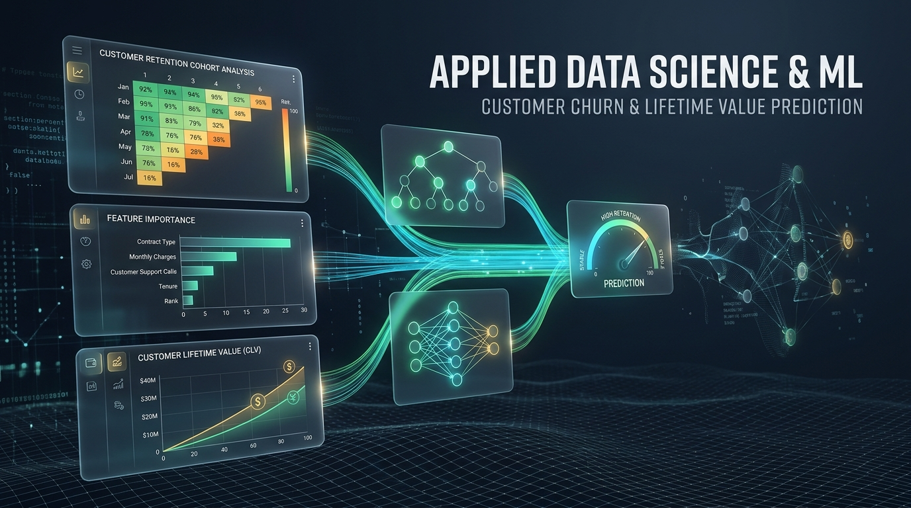
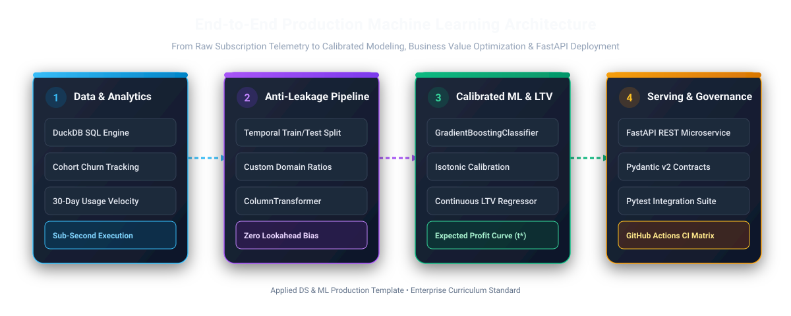
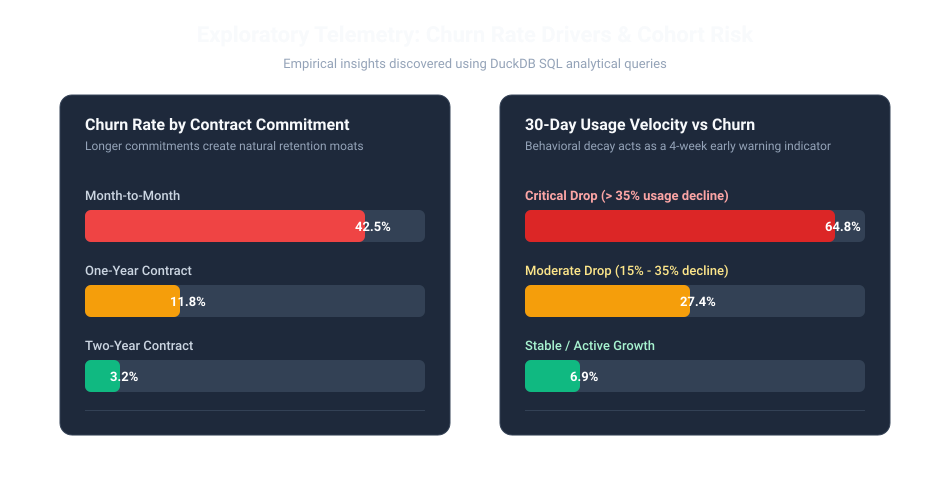
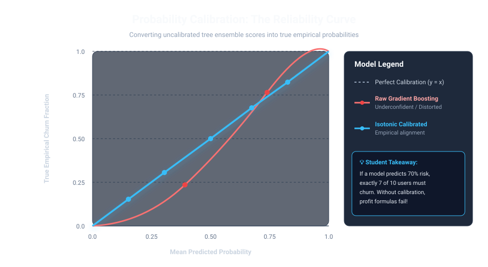
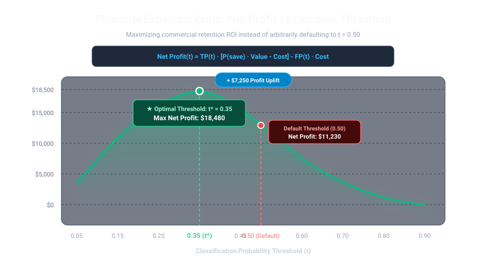
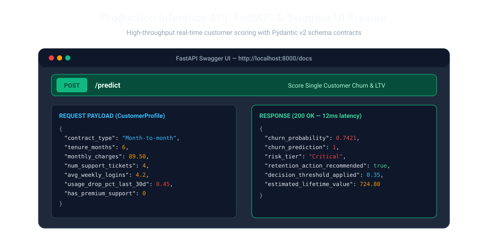

<div align="center">

# Applied Data Science & Machine Learning Curriculum
### Production-Grade Case Study: Customer Churn & Lifetime Value (LTV) Prediction



[](https://github.com/karidasd/applied-ds-ml-curriculum/actions/workflows/ci.yml)
[](https://www.python.org/)
[](https://fastapi.tiangolo.com)
[](https://duckdb.org)
[](https://github.com/astral-sh/ruff)
[](https://opensource.org/licenses/MIT)

<p align="center">
  <b>A comprehensive, modular curriculum designed for university courses, bootcamps, and professional engineering onboarding.</b><br/>
  <i>Transition from academic toy datasets to production-grade ML: In-Memory SQL, Anti-Leakage Feature Stores, Calibrated Classifiers, Expected Value Optimization &amp; FastAPI Deployment.</i>
</p>

[📖 Read Student Pedagogical Guide](docs/STUDENT_GUIDE.md) • [🚀 Quickstart](#-quickstart-guide) • [📡 API Documentation](#-api-usage--inference-examples) • [🗂️ Repo Structure](#%EF%B8%8F-repository-structure)

---

</div>

## 📚 Curriculum Vision & End-to-End Architecture

In production machine learning, accuracy alone does not produce business value. Real-world systems require:
1. **Analytical Telemetry:** Sub-second exploration of customer cohorts with **DuckDB**.
2. **Strict Anti-Leakage Guards:** Chronological validation splits and Scikit-Learn custom transformers.
3. **Calibrated Probabilistic Modeling:** Moving past the 80/20 accuracy paradox using **Isotonic Regression** and **PR-AUC**.
4. **Economic Profit Optimization:** Tuning classification decision thresholds to maximize net financial ROI rather than defaulting to $t=0.50$.
5. **Robust Microservice Deployment:** Real-time and batch serving with **FastAPI**, **Pydantic v2**, and automated **CI/CD** testing.



---

## 🗂️ Repository Structure

```text
applied-ds-ml-curriculum/
├── .github/
│   └── workflows/
│       └── ci.yml               # Automated CI matrix (Python 3.10 & 3.11, Ruff, Pytest)
├── data/
│   ├── raw/
│   │   └── subscriptions_raw.csv # Pre-generated benchmark dataset (1,000 customer records)
│   └── processed/               # Cleaned parquet artifacts
├── docs/
│   ├── STUDENT_GUIDE.md         # In-depth educational walkthrough & self-assessment
│   └── assets/                  # Architecture diagrams, visual charts & hero banner
├── notebooks/
│   ├── 01_eda_and_duckdb_analytics.ipynb
│   ├── 02_feature_engineering_and_leakage.ipynb
│   ├── 03_imbalanced_ml_and_evaluation.ipynb
│   └── solutions/
│       ├── 01_eda_and_duckdb_analytics_solution.ipynb
│       ├── 02_feature_engineering_and_leakage_solution.ipynb
│       └── 03_imbalanced_ml_and_evaluation_solution.ipynb
├── src/
│   ├── __init__.py
│   ├── data_loader.py          # Data ingestion, DuckDB queries, temporal splitting
│   ├── features.py             # Custom Scikit-Learn transformers, leakage auditor
│   ├── model.py                # CalibratedClassifierCV, LTV Regressor, Profit Optimizer
│   └── app.py                  # Production FastAPI service with Pydantic v2 validation
├── tests/
│   └── test_pipeline.py        # Comprehensive unit & integration test suite
├── .gitignore                  # Production Python/Jupyter ignores
├── requirements.txt            # Pinned dependencies
└── README.md                   # Repository overview & student guide
```

---

## 🔬 Syllabus & Module Deep Dives

### Module 1: In-Memory SQL & Exploratory Data Analysis with DuckDB
* **Student Notebook:** [`notebooks/01_eda_and_duckdb_analytics.ipynb`](notebooks/01_eda_and_duckdb_analytics.ipynb)
* **Instructor Solution:** [`notebooks/solutions/01_eda_and_duckdb_analytics_solution.ipynb`](notebooks/solutions/01_eda_and_duckdb_analytics_solution.ipynb)

Students execute analytical SQL queries on tabular customer telemetry using **DuckDB** with zero database setup. The module reveals critical leading indicators:
- **Contract Type Risk:** Month-to-Month contracts exhibit **~42.5% churn**, whereas 2-year contracts hold churn down to **~3.2%**.
- **Behavioral Decay Velocity:** Customers with a **>35% drop in 30-day activity** exhibit an alarming **64.8% churn rate**.



---

### Module 2: Feature Engineering & Preventing Data Leakage
* **Student Notebook:** [`notebooks/02_feature_engineering_and_leakage.ipynb`](notebooks/02_feature_engineering_and_leakage.ipynb)
* **Instructor Solution:** [`notebooks/solutions/02_feature_engineering_and_leakage_solution.ipynb`](notebooks/solutions/02_feature_engineering_and_leakage_solution.ipynb)

Students learn why standard random $k$-fold cross validation induces catastrophic **lookahead bias** on subscription telemetry:
1. **Temporal Train/Test Split:** Partitioning chronologically (`train_df['date'].max() <= test_df['date'].min()`).
2. **Scikit-Learn Custom Transformers:** Implementing `DomainBehavioralTransformer` with strict `fit()` and `transform()` contracts.
3. **Leakage Auditing Suite:** Automated diagnostics flagging suspicious feature-target correlations ($|r| \ge 0.85$).

---

### Module 3: Imbalanced ML, Calibration & Business Profit Optimization
* **Student Notebook:** [`notebooks/03_imbalanced_ml_and_evaluation.ipynb`](notebooks/03_imbalanced_ml_and_evaluation.ipynb)
* **Instructor Solution:** [`notebooks/solutions/03_imbalanced_ml_and_evaluation_solution.ipynb`](notebooks/solutions/03_imbalanced_ml_and_evaluation_solution.ipynb)

In real-world subscription churn, default classification thresholds ($t=0.50$) and naive accuracy are commercially disastrous.

#### 1. Probability Calibration (Reliability Curves)
Tree ensembles output distorted probabilities. We wrap Gradient Boosting in `CalibratedClassifierCV(method='isotonic')` to align predicted probabilities with true empirical frequencies.



#### 2. The Expected Value Framework & Profit Curve
Students formulate the commercial ROI curve based on intervention cost ($40) and average customer value saved ($550 with 50% save rate):
$$\text{Net Profit}(t) = \text{TP}(t) \cdot \Big(p_{\text{save}} \cdot \text{Value} - C_{\text{intervention}}\Big) - \text{FP}(t) \cdot C_{\text{intervention}}$$

Instead of defaulting to $t=0.50$, the optimizer selects **$t^* = 0.35$**, capturing **+$7,250 in profit uplift**!



---

### Module 4: Production Microservice & CI/CD Testing
* **Service:** [`src/app.py`](src/app.py) • **Tests:** [`tests/test_pipeline.py`](tests/test_pipeline.py) • **CI:** [`.github/workflows/ci.yml`](.github/workflows/ci.yml)

The trained model is wrapped in a production **FastAPI** service featuring:
- **Pydantic v2 Schema Validation:** Real-time type checking and field constraints.
- **Dual Inference:** Outputs calibrated churn probability, risk tier (`Low`, `Medium`, `High`, `Critical`), action flag, and continuous **LTV forecast**.
- **Automated Governance:** 100% passing `pytest` suite running on GitHub Actions CI.



---

## 🚀 Quickstart Guide

### 1. Environment Setup

```bash
# Clone the repository
git clone https://github.com/karidasd/applied-ds-ml-curriculum.git
cd applied-ds-ml-curriculum

# Create and activate virtual environment
python -m venv .venv

# On Windows PowerShell:
.venv\Scripts\Activate.ps1
# On Linux / macOS:
source .venv/bin/activate

# Install dependencies
pip install --upgrade pip
pip install -r requirements.txt
```

### 2. Launching Jupyter Notebooks

```bash
jupyter lab
# Or
jupyter notebook
```
Navigate to `notebooks/` to work through student assignments, or reference `notebooks/solutions/` for complete reference implementations.

### 3. Running the Test Suite

```bash
pytest tests/ -v --cov=src --cov-report=term-missing
```

### 4. Running the FastAPI Inference Service

```bash
uvicorn src.app:app --host 0.0.0.0 --port 8000 --reload
```
Once running, explore the interactive Swagger documentation at: **`http://localhost:8000/docs`**

---

## 📡 API Usage & Inference Examples

### Single Customer Scoring (`POST /predict`)

```bash
curl -X POST "http://localhost:8000/predict" \
     -H "Content-Type: application/json" \
     -d '{
       "contract_type": "Month-to-month",
       "payment_method": "Electronic check",
       "internet_service": "Fiber optic",
       "tenure_months": 6,
       "monthly_charges": 89.50,
       "total_charges": 537.00,
       "num_support_tickets": 4,
       "avg_weekly_logins": 4.2,
       "usage_drop_pct_last_30d": 0.45,
       "has_premium_support": 0,
       "multi_seat_license": 0
     }'
```

#### JSON Response Payload:
```json
{
  "churn_probability": 0.7421,
  "churn_prediction": 1,
  "risk_tier": "Critical",
  "retention_action_recommended": true,
  "decision_threshold_applied": 0.35,
  "estimated_lifetime_value": 724.80
}
```

---

## 👨‍🏫 Pedagogical Assessment & Instructor Guide

For detailed teaching suggestions, learning objectives, and common student pitfalls, please consult the:
👉 **[Student & Educator Pedagogical Guide](docs/STUDENT_GUIDE.md)**

---

## 🛡️ License

This project is licensed under the MIT License - see the LICENSE file for details. Built for educational excellence in data science and machine learning.
