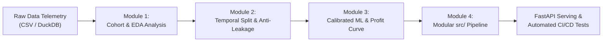

# Applied Data Science & Machine Learning Curriculum
## Production-Grade Case Study: Customer Churn & Lifetime Value (LTV) Prediction

[](https://github.com/organization/applied-ds-ml-curriculum/actions/workflows/ci.yml)
[](https://www.python.org/)
[](https://fastapi.tiangolo.com)
[](https://duckdb.org)
[](https://github.com/astral-sh/ruff)
[](https://opensource.org/licenses/MIT)

> **Curriculum Mission:** Transition from academic toy datasets and Kaggle-style notebooks to production-grade, modular, leak-free Machine Learning engineering. This curriculum guides students through exploratory SQL analytics, custom Scikit-Learn transformers, imbalanced learning, probability calibration, business profit threshold optimization, and live API deployment.

---

## 📚 Curriculum Roadmap & Case Study Overview

The course is built around **CloudStream**, a high-growth SaaS subscription platform facing customer attrition. Rather than treating churn as a detached statistical problem, students tackle both sides of customer retention:
1. **Binary Risk:** Will the customer cancel their subscription?
2. **Monetary Value:** What is their expected residual Lifetime Value (LTV)?
3. **Business Economics:** When is an intervention commercially viable?



---

## 🗂️ Repository Structure

```text
applied-ds-ml-curriculum/
├── .github/
│   └── workflows/
│       └── ci.yml               # Automated CI pipeline (linting, pytest, coverage)
├── data/
│   ├── raw/
│   │   └── subscriptions_raw.csv # Pre-generated realistic benchmark dataset (1,000 records)
│   └── processed/               # Cleaned parquet artifacts (generated during pipelines)
├── notebooks/
│   ├── 01_eda_and_duckdb_analytics.ipynb
│   ├── 02_feature_engineering_and_leakage.ipynb
│   ├── 03_imbalanced_ml_and_evaluation.ipynb
│   └── solutions/
│       ├── 01_eda_and_duckdb_analytics_solution.ipynb
│       ├── 02_feature_engineering_and_leakage_solution.ipynb
│       └── 03_imbalanced_ml_and_evaluation_solution.ipynb
├── src/
│   ├── __init__.py
│   ├── data_loader.py          # Data generation, DuckDB query engine, temporal splitting
│   ├── features.py             # Custom Scikit-Learn transformers, leakage auditor
│   ├── model.py                # CalibratedClassifierCV, LTV Regressor, Profit Optimizer
│   └── app.py                  # Production FastAPI service with Pydantic v2 validation
├── tests/
│   └── test_pipeline.py        # Comprehensive unit & integration test suite
├── .gitignore                  # Production Python/Jupyter ignores
├── requirements.txt            # Locked dependencies
└── README.md                   # Curriculum documentation & instructor guide
```

---

## 🔬 Syllabus & Module Deep Dives

### Module 1: In-Memory SQL & Exploratory Data Analysis with DuckDB
- **File:** `notebooks/01_eda_and_duckdb_analytics.ipynb`
- **Core Concepts:**
  - Running fast SQL queries directly on CSV/Parquet files and Pandas DataFrames with **DuckDB**.
  - Cohort analysis: Churn rates by contract type, payment channel, and tenure bands.
  - Behavioral leading indicators: 30-day usage velocity drops, support ticket spikes, and login cadence.
  - Dual-target dynamics: Visualizing churn distribution alongside customer Lifetime Value.

### Module 2: Feature Engineering & Preventing Data Leakage
- **File:** `notebooks/02_feature_engineering_and_leakage.ipynb`
- **Core Concepts:**
  - The three deadly sins of leakage: **Lookahead bias**, **Preprocessor leakage**, and **Target proxies**.
  - Chronological / Temporal train-test partitioning: `train_df['date'].max() <= test_df['date'].min()`.
  - Authoring custom, testable Scikit-Learn transformers inheriting from `BaseEstimator` and `TransformerMixin`.
  - Encapsulating feature logic in unified `ColumnTransformer` pipelines.
  - Automated leakage audits detecting suspicious feature-target Pearson correlations ($|r| \ge 0.85$).

### Module 3: Imbalanced ML, Calibration & Profit Curve Optimization
- **File:** `notebooks/03_imbalanced_ml_and_evaluation.ipynb`
- **Core Concepts:**
  - Overcoming the **Accuracy Paradox** in an 80/20 imbalanced dataset.
  - Beyond ROC-AUC: Why **PR-AUC (Average Precision)** and **Brier Score** matter.
  - Probability Calibration using **Isotonic Regression** and **Platt Scaling** (`CalibratedClassifierCV`).
  - **The Expected Value Framework:** Translating probabilities into business dollars:
    $$\text{Net Profit}(t) = \text{TP}(t) \cdot (p_{\text{save}} \times \text{LTV} - C) - \text{FP}(t) \cdot C$$
  - Graphing the financial profit curve to discover the profit-maximizing threshold $t^*$.
  - Continuous LTV regression for prioritized high-value retention campaigns.

### Module 4: Production Pipeline & FastAPI Microservice
- **Files:** `src/data_loader.py`, `src/features.py`, `src/model.py`, `src/app.py`, `tests/test_pipeline.py`
- **Core Concepts:**
  - Modular Python codebase conforming to production software engineering standards.
  - RESTful API with **FastAPI** and **Pydantic v2** schema validation.
  - Lifespan model bootstrapping: automatic training or deserialization upon boot.
  - Single customer and high-throughput batch scoring endpoints.
  - Full automated testing suite with `pytest` and GitHub Actions CI.

---

## 🚀 Quickstart Guide

### 1. Prerequisites
- Python 3.10 or 3.11
- Git

### 2. Environment Setup

```bash
# Clone the repository
git clone https://github.com/organization/applied-ds-ml-curriculum.git
cd applied-ds-ml-curriculum

# Create and activate virtual environment
python -m venv .venv

# On Linux/macOS:
source .venv/bin/activate
# On Windows PowerShell:
.venv\Scripts\Activate.ps1

# Install production and development dependencies
pip install --upgrade pip
pip install -r requirements.txt
```

### 3. Running Jupyter Notebooks

```bash
jupyter lab
# Or
jupyter notebook
```
Navigate to `notebooks/` to work through student assignments, or reference `notebooks/solutions/` for reference implementations.

### 4. Running the Test Suite

```bash
# Run all unit and integration tests with coverage report
pytest tests/ -v --cov=src --cov-report=term-missing
```

### 5. Launching the Inference API

```bash
uvicorn src.app:app --host 0.0.0.0 --port 8000 --reload
```

Once running, access:
- Interactive API Docs (Swagger UI): **http://localhost:8000/docs**
- Alternative Docs (ReDoc): **http://localhost:8000/redoc**
- Health Probe: **http://localhost:8000/health**

---

## 📡 API Usage & Inference Examples

### Single Customer Scoring (`POST /predict`)

```bash
curl -X POST "http://localhost:8000/predict" \
     -H "Content-Type: application/json" \
     -d '{
       "contract_type": "Month-to-month",
       "payment_method": "Electronic check",
       "internet_service": "Fiber optic",
       "tenure_months": 6,
       "monthly_charges": 89.50,
       "total_charges": 537.00,
       "num_support_tickets": 4,
       "avg_weekly_logins": 5.2,
       "usage_drop_pct_last_30d": 0.45,
       "has_premium_support": 0,
       "multi_seat_license": 0
     }'
```

#### Sample Response:
```json
{
  "churn_probability": 0.7421,
  "churn_prediction": 1,
  "risk_tier": "Critical",
  "retention_action_recommended": true,
  "decision_threshold_applied": 0.35,
  "estimated_lifetime_value": 724.80
}
```

### Batch Scoring (`POST /predict/batch`)

```bash
curl -X POST "http://localhost:8000/predict/batch" \
     -H "Content-Type: application/json" \
     -d '{
       "customers": [
         {
           "contract_type": "Two year",
           "payment_method": "Credit card",
           "internet_service": "DSL",
           "tenure_months": 48,
           "monthly_charges": 45.00,
           "total_charges": 2160.00,
           "num_support_tickets": 0,
           "avg_weekly_logins": 18.5,
           "usage_drop_pct_last_30d": -0.05,
           "has_premium_support": 1,
           "multi_seat_license": 1
         }
       ]
     }'
```

---

## 👨‍🏫 Instructor & Pedagogical Guide

| Module | Student Exercises | Key Pitfalls to Watch Out For |
|---|---|---|
| **Module 1 (EDA & DuckDB)** | Cohort SQL aggregation, usage trajectory bucketing | Students using Pandas loops instead of vectorized SQL queries. |
| **Module 2 (Anti-Leakage)** | Temporal splitting, domain interaction transformer | Students fitting scalers on the entire dataset prior to splitting. |
| **Module 3 (Imbalanced ML)** | Calibration curve evaluation, profit curve threshold optimization | Defaulting to 0.50 threshold and claiming high accuracy on imbalanced data. |
| **Module 4 (Deployment)** | Pydantic validation, pipeline persistence, unit testing | Hardcoding paths or mutating state across concurrent API requests. |

---

## 🛡️ License

This project is licensed under the MIT License - see the LICENSE file for details. Designed for production educational environments, bootcamps, and enterprise machine learning onboarding.
