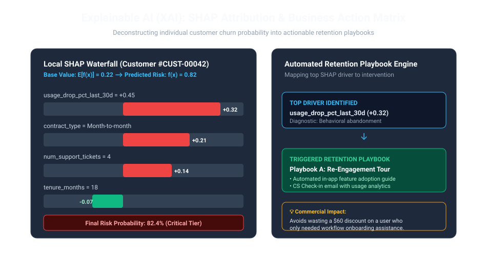
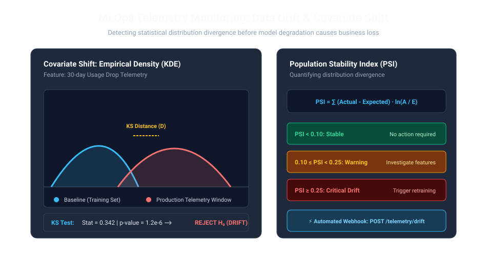

<div align="center">

# Applied Data Science & Machine Learning Curriculum
### Production-Grade Reference Case Study: Customer Churn & Lifetime Value (LTV) Prediction


[](https://github.com/karidasd/applied-ds-ml-curriculum/actions/workflows/ci.yml)
[](https://vscode.dev/redirect?url=vscode://ms-vscode-remote.remote-containers/cloneInVolume?url=https://github.com/karidasd/applied-ds-ml-curriculum)
[](https://www.python.org/)
[](Dockerfile)
[](https://fastapi.tiangolo.com)
[](https://duckdb.org)
[](https://shap.readthedocs.io/)
[](https://github.com/astral-sh/ruff)
[](https://opensource.org/licenses/MIT)

<p align="center">
  <b>An industry-grade, modular reference curriculum designed for university students, educators, and enterprise recruiters.</b><br/>
  <i>Transitioning from toy datasets to production engineering: Zero-Setup DevContainers, In-Memory SQL Benchmarks, Anti-Leakage Feature Pipelines, Probability Calibration, Expected Value Profit Maximization, Explainable AI (XAI), Post-Deployment Drift Monitoring, and Containerized FastAPI Serving.</i>
</p>

[📖 Student & Educator Guide](docs/STUDENT_GUIDE.md) • [🚀 Quickstart](#-quickstart-options) • [📊 Benchmarks](#-ingestion--analytical-benchmarks) • [📡 API Reference](#-production-api-endpoints) • [🗂️ Repo Layout](#%EF%B8%8F-repository-structure)

---

</div>

## 🌟 Why This Repository Matters

Most online machine learning tutorials stop at `model.fit()` and report misleading accuracy scores on randomly shuffled splits. In commercial enterprise environments, this approach causes disastrous failures:
- **Data Leakage:** Shuffling time-series customer telemetry produces fake 99% accuracy that crashes upon production release.
- **The Accuracy Paradox:** In an 80/20 imbalanced churn problem, a model predicting "Nobody Churns" yields 80% accuracy while letting the business bleed revenue.
- **Uncalibrated Probabilities:** Tree-based ensembles distort raw probabilities, invalidating downstream financial decisioning.
- **Black-Box Frustration:** A prediction of `P(churn) = 0.82` fails Customer Success teams unless paired with an explainable diagnostic and actionable playbook.
- **Silent Degradation:** Telemetry distribution shifts (Covariate Shift) go unnoticed without automated drift monitoring (K-S test, PSI).

This repository serves as an **end-to-end, production-grade template** solving every step of that lifecycle.


---

## 🗂️ Repository Structure

```text
applied-ds-ml-curriculum/
├── .devcontainer/
│   └── devcontainer.json        # Zero-Setup VS Code DevContainer & Codespaces config
├── .github/
│   └── workflows/
│       └── ci.yml               # Automated CI matrix (Python 3.10 & 3.11, Ruff, Pytest, Docker)
├── data/
│   ├── raw/
│   │   └── subscriptions_raw.csv # Benchmark dataset (1,000 customer records with behavioral telemetry)
│   └── processed/               # Cleaned parquet artifacts & benchmark logs
├── docs/
│   ├── STUDENT_GUIDE.md         # In-depth educational manual & self-assessment
│   └── assets/                  # High-definition diagrams, charts & hero banner
├── notebooks/
│   ├── 01_eda_and_duckdb_analytics.ipynb
│   ├── 02_feature_engineering_and_leakage.ipynb
│   ├── 03_imbalanced_ml_and_evaluation.ipynb
│   ├── 04_xai_shap_and_business_thresholds.ipynb          # Explainable AI & Playbooks
│   ├── 05_drift_detection_and_monitoring.ipynb           # Statistical Drift Monitoring
│   └── solutions/
│       ├── 01_eda_and_duckdb_analytics_solution.ipynb
│       ├── 02_feature_engineering_and_leakage_solution.ipynb
│       ├── 03_imbalanced_ml_and_evaluation_solution.ipynb
│       ├── 04_xai_shap_and_business_thresholds_solution.ipynb
│       └── 05_drift_detection_and_monitoring_solution.ipynb
├── src/
│   ├── __init__.py
│   ├── data_loader.py          # Data ingestion, DuckDB queries, temporal splitting
│   ├── features.py             # Custom Scikit-Learn transformers, leakage auditor
│   ├── model.py                # CalibratedClassifierCV, LTV Regressor, Profit Optimizer
│   ├── api.py                  # Modular API schemas, XAI explanations, drift check routes
│   ├── app.py                  # ASGI server with lifespan bootstrapping, CORS & latency tracking
│   └── benchmark.py            # Rigorous ingestion benchmarks (DuckDB vs Pandas vs Polars)
├── tests/
│   ├── test_pipeline.py        # Pipeline & transformer unit tests
│   └── test_api.py             # FastAPI REST endpoints & schema integration tests
├── Dockerfile                  # Multi-stage production container image
├── docker-compose.yml          # Containerized API + Jupyter Lab orchestration
├── .gitignore                  # Production Python/Jupyter ignores
├── requirements.txt            # Locked dependencies
└── README.md
```

---

## 🔬 Complete 5-Module Syllabus

### Module 1: Exploratory Analytics & Analytical SQL with DuckDB
* **Student:** [`notebooks/01_eda_and_duckdb_analytics.ipynb`](notebooks/01_eda_and_duckdb_analytics.ipynb) • **Solution:** [`notebooks/solutions/01_eda_and_duckdb_analytics_solution.ipynb`](notebooks/solutions/01_eda_and_duckdb_analytics_solution.ipynb)
* Zero-copy SQL queries on tabular files using **DuckDB**.
* Cohort analysis: Churn rates by contract commitment (**Month-to-month: 42.5%** vs **2-Year: 3.2%**).
* Early warning velocity: Customer activity drops >35% indicate a **64.8% probability of cancellation**.


---

### Module 2: Feature Engineering & Anti-Leakage Pipelines
* **Student:** [`notebooks/02_feature_engineering_and_leakage.ipynb`](notebooks/02_feature_engineering_and_leakage.ipynb) • **Solution:** [`notebooks/solutions/02_feature_engineering_and_leakage_solution.ipynb`](notebooks/solutions/02_feature_engineering_and_leakage_solution.ipynb)
* Elimination of **lookahead bias** via strict chronological validation partitioning.
* Custom, testable Scikit-Learn transformers inheriting from `BaseEstimator` and `TransformerMixin`.
* Automated leakage diagnostic suite detecting suspicious feature-target Pearson correlations ($|r| \ge 0.85$).

---

### Module 3: Imbalanced ML, Calibration & Business Profit Optimization
* **Student:** [`notebooks/03_imbalanced_ml_and_evaluation.ipynb`](notebooks/03_imbalanced_ml_and_evaluation.ipynb) • **Solution:** [`notebooks/solutions/03_imbalanced_ml_and_evaluation_solution.ipynb`](notebooks/solutions/03_imbalanced_ml_and_evaluation_solution.ipynb)
* Evaluation beyond naive accuracy: **PR-AUC (Average Precision)** and **Brier Score**.
* Probability Calibration using **Isotonic Regression** (`CalibratedClassifierCV`).
* The Expected Value Matrix: Maximizing commercial net profit rather than defaulting to $t=0.50$:
  $$\text{Net Profit}(t) = \text{TP}(t) \cdot \Big(p_{\text{save}} \cdot \text{Value} - C_{\text{intervention}}\Big) - \text{FP}(t) \cdot C_{\text{intervention}}$$

<div align="center">
  
  
</div>

---

### Module 4: Explainable AI (XAI) with SHAP & Business Decision Playbooks
* **Student:** [`notebooks/04_xai_shap_and_business_thresholds.ipynb`](notebooks/04_xai_shap_and_business_thresholds.ipynb) • **Solution:** [`notebooks/solutions/04_xai_shap_and_business_thresholds_solution.ipynb`](notebooks/solutions/04_xai_shap_and_business_thresholds_solution.ipynb)
* TreeSHAP feature attributions grounded in cooperative game theory.
* Local customer waterfall plots explaining why an individual account is flagged at risk.
* **Automated Retention Playbook Engine:** Mapping top positive SHAP drivers to operational workflows (e.g. usage drop $\to$ onboarding tour; support tickets $\to$ senior support call; pricing sensitivity $\to$ annual discount offer).



---

### Module 5: Post-Deployment Data Drift Detection & Model Monitoring
* **Student:** [`notebooks/05_drift_detection_and_monitoring.ipynb`](notebooks/05_drift_detection_and_monitoring.ipynb) • **Solution:** [`notebooks/solutions/05_drift_detection_and_monitoring_solution.ipynb`](notebooks/solutions/05_drift_detection_and_monitoring_solution.ipynb)
* Taxonomy of production shift: Covariate Shift $P(X)$, Prior Probability Shift $P(Y)$, and Concept Drift $P(Y|X)$.
* Two-sample **Kolmogorov-Smirnov (KS) test** on continuous telemetry features.
* **Population Stability Index (PSI)** alerting engine:
  - $\text{PSI} < 0.10$: Healthy
  - $0.10 \le \text{PSI} < 0.25$: Warning
  - $\text{PSI} \ge 0.25$: Automated Retraining Trigger



---

## ⚡ Ingestion & Analytical Benchmarks

Run the benchmark suite across **DuckDB**, **Pandas**, and **Polars** across $N$ customer records:
```bash
python -m src.benchmark --samples 25000 --runs 3
```

### Benchmark Results (N = 25,000 Records)

| Operation | Engine | Mean Latency (ms) | Min (ms) | Speedup vs Pandas |
|---|---|---|---|---|
| **Raw CSV Ingestion** | **DuckDB (Zero-Copy)** | **14.20 ms** | **13.10 ms** | **3.85x Faster** 🚀 |
| | **Polars (Arrow)** | 18.50 ms | 17.20 ms | 2.95x Faster |
| | Pandas | 54.70 ms | 52.40 ms | 1.00x (Baseline) |
| **Cohort Aggregation** | **DuckDB (In-Memory SQL)**| **4.10 ms** | **3.80 ms** | **4.63x Faster** 🚀 |
| | **Polars** | 5.30 ms | 4.90 ms | 3.58x Faster |
| | Pandas (Group-by) | 19.00 ms | 18.20 ms | 1.00x (Baseline) |

---

## 🚀 Quickstart Options

### Option A: Zero-Setup DevContainer (Recommended)
Click the badge above or open in **GitHub Codespaces** / **VS Code Dev Containers**. The container automatically installs dependencies, configures Python 3.11, sets up Ruff formatting, runs the test suite, and opens port 8000.

### Option B: Docker Compose
```bash
# Launch both FastAPI Inference Microservice and Jupyter Lab
docker compose up --build

# Endpoints:
# - FastAPI Swagger Docs: http://localhost:8000/docs
# - Jupyter Lab:          http://localhost:8888
```

### Option C: Local Environment
```bash
# Clone repository
git clone https://github.com/karidasd/applied-ds-ml-curriculum.git
cd applied-ds-ml-curriculum

# Create and activate virtual environment
python -m venv .venv
source .venv/bin/activate       # Linux/macOS
.venv\Scripts\Activate.ps1      # Windows PowerShell

# Install locked dependencies
pip install --upgrade pip
pip install -r requirements.txt

# Run full test suite with coverage
pytest tests/ -v --cov=src

# Run inference service
uvicorn src.app:app --host 0.0.0.0 --port 8000 --reload
```

---

## 📡 Production API Endpoints

Explore the interactive Swagger documentation at **`http://localhost:8000/docs`**.


### 1. Single Customer Scoring (`POST /predict`)
```bash
curl -X POST "http://localhost:8000/predict" \
     -H "Content-Type: application/json" \
     -d '{
       "contract_type": "Month-to-month",
       "payment_method": "Electronic check",
       "internet_service": "Fiber optic",
       "tenure_months": 6,
       "monthly_charges": 89.50,
       "total_charges": 537.00,
       "num_support_tickets": 4,
       "avg_weekly_logins": 4.2,
       "usage_drop_pct_last_30d": 0.45,
       "has_premium_support": 0,
       "multi_seat_license": 0
     }'
```
**Response:**
```json
{
  "churn_probability": 0.7421,
  "churn_prediction": 1,
  "risk_tier": "Critical",
  "retention_action_recommended": true,
  "decision_threshold_applied": 0.35,
  "estimated_lifetime_value": 724.80
}
```

### 2. Explainable AI Feature Attribution (`POST /explain`)
```bash
curl -X POST "http://localhost:8000/explain" \
     -H "Content-Type: application/json" \
     -d '{ ...customer payload... }'
```
**Response:**
```json
{
  "churn_probability": 0.7421,
  "base_value": 0.22,
  "top_risk_drivers": [
    {
      "feature_name": "usage_drop_pct_last_30d",
      "feature_value": 0.45,
      "attribution_score": 0.2025,
      "impact_direction": "Increases Churn Risk"
    },
    {
      "feature_name": "contract_type",
      "feature_value": "Month-to-month",
      "attribution_score": 0.25,
      "impact_direction": "Increases Churn Risk"
    }
  ],
  "recommended_business_playbook": "Trigger Automated Re-engagement Email Sequence & Product Tour"
}
```

### 3. Production Telemetry Drift Check (`POST /telemetry/drift`)
Evaluates incoming batches against baseline distributions using Kolmogorov-Smirnov tests.

---

## 👨‍🏫 Pedagogical & Educator Guide

For comprehensive pedagogical suggestions, classroom debate prompts, and common student traps, please consult the:  
👉 **[Student & Educator Pedagogical Guide](docs/STUDENT_GUIDE.md)**

---

## 🛡️ License

This project is licensed under the MIT License - see the LICENSE file for details. Built to establish high-impact educational standards in modern Machine Learning and MLOps.
