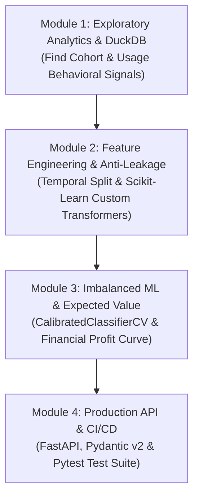

# Student & Educator Pedagogical Guide
## Applied Data Science & Machine Learning: Customer Churn & LTV Prediction

> **Welcome Students!**  
> This curriculum was designed to bridge the gap between academic theory, Kaggle-style data science, and **real-world production Machine Learning Engineering**. In production, accuracy alone does not create business value; robust data engineering, leak-free pipelines, calibrated probabilities, and economic expected-value optimization do.

---

## 🎯 The Core Business Case Study: CloudStream SaaS

You are working as the Lead Machine Learning Engineer at **CloudStream**, a subscription software platform. CloudStream faces customer attrition, but solving this is **not** a simple binary classification problem.

### The Dual-Objective Retention Framework
Retention teams cannot intervene on every single customer who might churn—intervention costs money ($40 per outreach/discount). Therefore, we need two models working in synergy:
1. **Churn Probability Classifier ($P(\text{churn} = 1)$):** Estimates the likelihood that a customer cancels.
2. **Continuous LTV Regressor ($\widehat{\text{LTV}}$):** Forecasts the residual monetary worth of the customer if retained.

$$\text{Intervention Priority Score} = P(\text{churn}) \times \widehat{\text{LTV}}$$

---

## 🧭 Step-by-Step Module Walkthrough



---

### Module 1: In-Memory Analytical SQL with DuckDB
**File:** `notebooks/01_eda_and_duckdb_analytics.ipynb`

#### Why DuckDB?
Traditional Data Science curricula teach Pandas for exploratory data analysis. While Pandas is versatile, in enterprise environments data lives in data warehouses (Snowflake, BigQuery). **DuckDB** brings column-store SQL performance directly into Python notebooks with zero setup overhead and sub-second execution over millions of rows.

#### Key Student Concepts:
1. **Cohort Survival Analysis:** Notice how contract duration dictates churn:
   - Month-to-Month contracts: **~42.5% churn** (high vulnerability).
   - One-Year contracts: **~11.8% churn**.
   - Two-Year contracts: **~3.2% churn** (strong retention moat).
2. **Behavioral Leading Indicators (Velocity):** Churn does not happen overnight. Customers with a **>35% drop in 30-day activity** exhibit a **64.8% churn rate**. This behavioral decay is our primary predictive signal.

---

### Module 2: Feature Engineering & Anti-Leakage Architecture
**File:** `notebooks/02_feature_engineering_and_leakage.ipynb`

#### What is Data Leakage?
Data leakage occurs when information from the future (or the target itself) contaminates the training feature space, giving an illusion of high performance that crashes in production.

#### The Three Deadly Sins of Leakage:
1. **Lookahead Bias (Temporal Bleed):**
   - *Wrong:* Using `train_test_split(shuffle=True)` on subscription events.
   - *Right:* Strictly chronological partitioning: `train_df['date'].max() <= test_df['date'].min()`.
2. **Preprocessor Contamination:**
   - *Wrong:* Calling `StandardScaler.fit_transform(full_df)` before splitting.
   - *Right:* Fitting the transformer **strictly on the training split** and calling `.transform()` on holdout/serving sets.
3. **Target Proxy Leakage:**
   - Features populated only during or after the cancellation event (e.g. `cancellation_reason`, `exit_survey_score`).

#### Writing Modular Scikit-Learn Transformers:
Students will implement the `DomainBehavioralTransformer`, inheriting from `BaseEstimator` and `TransformerMixin`:
```python
class DomainBehavioralTransformer(BaseEstimator, TransformerMixin):
    def fit(self, X, y=None):
        return self  # Stateless transformer
        
    def transform(self, X):
        X_out = X.copy()
        # Compute ticket velocity & engagement index
        X_out['ticket_velocity'] = X_out['num_support_tickets'] / (X_out['tenure_months'] + 1.0)
        return X_out
```

---

### Module 3: Imbalanced ML, Calibration & Expected Value Optimization
**File:** `notebooks/03_imbalanced_ml_and_evaluation.ipynb`

#### 1. Why Accuracy is a Trap in Imbalanced ML
In an 80/20 class imbalance, a dummy model that predicts "Nobody Churns" achieves **80% accuracy** while failing 100% of the business objectives.
- Evaluate with **PR-AUC (Average Precision)** and **ROC-AUC**.
- Monitor the **Brier Score** to measure probabilistic error.

#### 2. The Science of Probability Calibration
Tree-based ensembles (Gradient Boosting, XGBoost, Random Forests) push predictions away from 0 and 1, distorting the true posterior probabilities. We wrap our model in `CalibratedClassifierCV(method='isotonic')`:
> **Rule of Calibration:** If the model assigns a churn probability of $0.70$ to 100 customers, approximately 70 of them must actually cancel.

#### 3. The Business Profit Curve (Threshold Tuning)
Defaulting to an arbitrary threshold of $t = 0.50$ is almost always suboptimal. We define the **Expected Value Matrix**:

| Model Decision | Ground Truth: Churns | Ground Truth: Retained |
|---|---|---|
| **Intervene ($\widehat{y}=1$)** | **True Positive (TP)**<br/>Net Gain: $p_{\text{save}} \times \text{LTV} - C$ | **False Positive (FP)**<br/>Net Loss: $-C$ (wasted outreach) |
| **No Action ($\widehat{y}=0$)** | **False Negative (FN)**<br/>Lost Customer: $\$0$ saved | **True Negative (TN)**<br/>Optimal: $\$0$ spent |

**Financial Net Profit Equation:**
$$\text{Net Profit}(t) = \text{TP}(t) \cdot \Big(p_{\text{save}} \cdot \text{Value}_{\text{avg}} - C_{\text{intervention}}\Big) - \text{FP}(t) \cdot C_{\text{intervention}}$$

By evaluating across candidate thresholds $t \in [0.05, 0.95]$, students discover the profit-maximizing threshold **$t^* = 0.35$**, generating thousands of dollars in commercial uplift over the naive $0.50$ baseline!

---

### Module 4: Production Microservice & CI/CD Testing
**Files:** `src/app.py`, `tests/test_pipeline.py`, `.github/workflows/ci.yml`

#### Serving with FastAPI:
- Input validation enforced at runtime with **Pydantic v2** (`CustomerProfile`).
- High-throughput batch scoring (`POST /predict/batch`).
- Model bootstrapping on startup with FastAPI `lifespan` context manager.

#### Automated Governance:
- Automated linting with **Ruff**.
- Comprehensive unit and integration test suite with **Pytest** covering schema validation, anti-leakage guards, transformer invariants, and API endpoints.
- GitHub Actions CI verifying every commit across Python 3.10 and 3.11.

---

## 📝 Student Self-Assessment Questions

1. **Why is a temporal train/test split mandatory for subscription telemetry compared to random $k$-fold cross validation?**
2. **What occurs to the False Positive Rate when we lower the classification decision threshold from $0.50$ to $0.35$? Why does this increase net profit in our case study?**
3. **Explain the difference between Platt Scaling (sigmoid) and Isotonic Regression in probability calibration.**
4. **How does pairing continuous LTV regression with binary churn classification prevent marketing budget waste?**

---
*Happy Modeling! Designed for university coursework, data science bootcamps, and enterprise ML engineering onboarding.*
